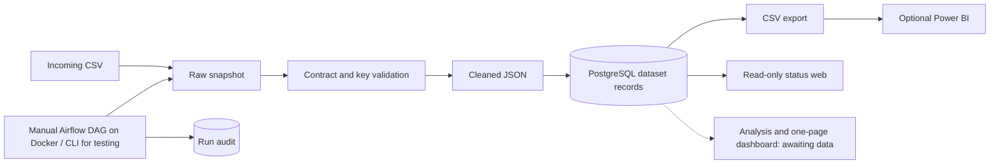

# การออกแบบโครงเริ่มต้น

ยืมการแบ่งโฟลเดอร์และลำดับ ETL จาก Thailand Rainfall Observatory แต่ไม่ใช้ API ฝน พิกัดจังหวัด ชื่อ metric เกณฑ์อากาศ หรือข้อมูลต้นฉบับ

ขอบเขตหลักเป็นระบบวิเคราะห์ขนาดเล็กในเครื่อง ใช้ Python + Airflow + Docker + PostgreSQL และเว็บหน้าเดียวตามแนวทางที่อาจารย์สอน ข้อมูลหลักหนึ่งชุด คำถามวิเคราะห์ 2–3 ข้อ SQLite ใช้ทดสอบแยกโดยไม่เปิด Docker และ Power BI เป็นทางเลือก ตัวอย่างร้านอาหารที่ผู้ใช้ยกมาช่วยกำหนดระดับความซับซ้อน แต่ไม่ได้เปลี่ยน contract ให้เป็นข้อมูลร้านอาหาร

## ขอบเขตของข้อมูล

`columns` และ `key_columns` เริ่มว่างเพื่อไม่เลือกหัวข้อแทนผู้ใช้ ทุกคอลัมน์ใน CSV ต้องเรียงตาม contract ค่าถูกตัดช่องว่างหัวท้ายและเก็บเป็นข้อความ ไม่คาดเดาชนิดหรือแก้ข้อมูลเสียเอง คีย์ที่ว่างหรือซ้ำในไฟล์เดียวทำให้ทั้งรอบล้มเหลวก่อนแตะข้อมูลเดิม

คีย์ฐานข้อมูลเป็น SHA-256 ของ JSON array ของค่าคีย์ตามลำดับที่กำหนด จึงไม่เกิดปัญหาค่าที่มีตัวคั่นเหมือนกัน ทุกแถวเก็บ payload JSON text ในตารางกลาง ไม่อ้างว่าเป็น fact table ของหัวข้อที่ยังไม่ทราบ

Contract ถูกบันทึกเมื่อโหลดสำเร็จครั้งแรกและต้องตรงกันทุกรอบถัดไป ไม่อนุญาตให้เปลี่ยนคีย์แล้วนำข้อมูลต่างความหมายมาปะปนกัน เมื่อเปลี่ยนชุดข้อมูลให้ใช้ฐานใหม่หรือวางแผน migration ห้ามลบฐานเดิมเพื่อแก้ปัญหาโดยไม่ได้สำรอง

## ความถูกต้องและการกู้คืน

- โหลดแบบ upsert ใน transaction และอ่านตรวจ payload ก่อน commit; คีย์ที่ไม่อยู่ในไฟล์ใหม่ยังอยู่ในฐาน
- เก็บ raw และ cleaned แยก run ID ไม่เขียนทับหลักฐานเดิม
- Audit บันทึก RUNNING/SUCCESS/FAILED พร้อมขั้นตอนและข้อผิดพลาด เวลาเป็น UTC
- CSV เขียนไฟล์ชั่วคราวแล้ว replace แบบ atomic เพื่อไม่ทิ้งรายงานครึ่งไฟล์
- ถ้า export ล้มเหลวหลัง commit ฐานจะมีข้อมูลใหม่ แต่ CSV อาจยังเก่า Audit เป็น FAILED ที่ขั้น export ให้แก้สาเหตุแล้วรันซ้ำ หรือสั่ง export ใหม่
- หาก process ถูก kill ทันที Audit อาจค้าง RUNNING ต้องตรวจ log ก่อน retry
- ไม่ส่ง raw rows เข้า Airflow XCom; DAG เรียก Pipeline เดียวกับ CLI และใช้ `max_active_runs=1`

## ข้อจำกัดที่ตั้งใจไว้

รับ CSV ทีละไฟล์ด้วยการสั่งรันเอง ยังไม่มี source adapter สำหรับ API หรือ schedule อัตโนมัติ ยังไม่คำนวณ mart/ตัวชี้วัดก่อนรู้ข้อมูล ข้อมูลหนึ่ง batch อยู่ในหน่วยความจำและตรวจ payload ทีละแถว เหมาะสำหรับเริ่มโครงการ; เมื่อทราบขนาดจริงจึงเปลี่ยนเป็น streaming/staging และ bulk validation พร้อม benchmark

ให้มีผู้เขียนฐานและไฟล์ส่งออกเพียงหนึ่งรายต่อครั้ง อย่ารัน CLI พร้อม DAG ไม่รองรับหลาย dataset ในฐานเดียว ไม่มี authentication สำหรับหน้าเว็บ จึงเปิดเฉพาะเครื่องตัวเอง หน้าเว็บไม่แสดง payload หรือรายละเอียด error; รายละเอียด audit อยู่ในฐานและ CLI

ไฟล์จริง raw/cleaned/export/ฐาน/.env ถูก ignore ใน Git แต่ยังอยู่บนดิสก์ ต้องกำหนดสิทธิ์เครื่องและ retention เมื่อทราบความอ่อนไหวของข้อมูล ไม่มีการลบข้อมูลเก่าอัตโนมัติ
