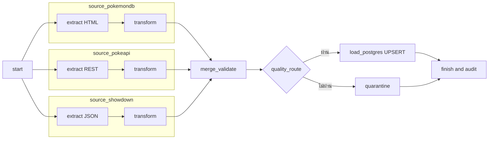

# Pokédex Observatory

**02739452 · ลำดับที่ 19 · รหัสนิสิต 6621601093**

ระบบรวบรวมข้อมูล Pokémon หมายเลข National Pokédex **1–151 เฉพาะร่างปกติ** จาก 3 แหล่ง ด้วย Apache Airflow TaskGroups บน Docker รวมเป็น schema เดียวใน PostgreSQL และแสดง dashboard ที่พัฒนาเองด้วย Python/HTML/CSS/JavaScript

Repository: https://github.com/PasitPukang/02739452-19-6621601093

## แหล่งข้อมูล

| แหล่ง | วิธีดึง | ข้อมูล |
| --- | --- | --- |
| [Pokémon Database](https://pokemondb.net/pokedex/all) | **Web scraping ตาราง HTML** ด้วย Python HTMLParser ไม่ใช้ Selenium | ชื่อ ประเภท ค่าสถิติ และหมายเลข |
| [PokéAPI](https://pokeapi.co/docs/v2) | Public REST API `/api/v2/pokemon?limit=151&offset=0` และ detail URL | ชื่อ ประเภท ค่าสถิติ และหมายเลข |
| [Pokémon Showdown](https://play.pokemonshowdown.com/data/pokedex.json) | Public JSON | ชื่อ ประเภท ค่าสถิติ และหมายเลข |

ตรวจ `robots.txt` ทุก origin ก่อนดึง เคารพ `Crawl-delay` (Pokémon Database 2 วินาที) และ cache รายละเอียด PokéAPI 24 ชั่วโมงตามแนวทาง Fair Use ไม่เก็บข้อมูลผู้เล่น บัญชี อีเมล เบอร์โทร หรือข้อมูลบุคคล เก็บ HTML เฉพาะตารางข้อมูลเกม ไม่เก็บหน้าบัญชี/ชุมชน/ความคิดเห็น ไม่ใช้ Selenium

ข้อมูลหมายถึงค่าสถิติพื้นฐานปัจจุบันของตัวละครหมายเลข 1–151 ไม่ใช่สถิติจากเกมภาค Gen 1 ดั้งเดิม ไม่นำ Mega/Regional forms มารวมกับร่างปกติ เมื่อสถิติต่างกันจะบันทึก conflict และเลือกลำดับ **PokéAPI → Pokémon Database → Showdown** โดยไม่คำนวณค่าเฉลี่ยข้ามแหล่ง

## เปิดระบบจาก repository

ต้องมี Docker Desktop พร้อม Linux containers และอินเทอร์เน็ตสำหรับ build/ดึงข้อมูล ใช้ Airflow 2.11.2 / Python 3.12 / PostgreSQL 16 ไม่ต้องมี API key, Node หรือ Python บน host เพื่อรันระบบหลัก

```powershell
git clone https://github.com/PasitPukang/02739452-19-6621601093.git
cd 02739452-19-6621601093
Copy-Item .env.example .env
notepad .env
```

กำหนด `POSTGRES_PASSWORD` และ `AIRFLOW_ADMIN_PASSWORD` เป็นรหัสที่เลือกเอง ใช้ตัวอักษรอังกฤษและตัวเลขเพื่อใช้ใน connection URL ได้ตรง ๆ ห้ามนำ `.env` ขึ้น Git รหัสสองตัวนี้เป็นของเครื่องที่รัน ไม่ต้องใช้รหัสของผู้พัฒนา

```powershell
docker compose up -d --build
docker compose ps --all
```

รอ PostgreSQL healthy และ init ทั้งสองตัวจบ Exited (0) แล้วเปิด:

- **Dashboard:** http://localhost:8091
- **Airflow:** http://localhost:8089 — username `admin`, password จาก `AIRFLOW_ADMIN_PASSWORD`
- **PostgreSQL:** `127.0.0.1:55433`, database `project`, username `airflow`, password จาก `POSTGRES_PASSWORD`

พอร์ตเผยแพร่เฉพาะ localhost Dashboard อ่านตาราง PostgreSQL ผ่าน SQLAlchemy โดยตรง ไม่อ่าน CSV/JSON มาแทนฐานข้อมูล ไม่มีการนำ `.env` ไปแสดงในเว็บ

## รัน DAG

เลือก **`pokemon_pipeline`** เปิดสวิตช์เป็น Unpaused แล้วกด Trigger ด้วยค่าเริ่มต้น หรือใช้:

```powershell
docker compose exec airflow-scheduler airflow dags unpause pokemon_pipeline
docker compose exec airflow-scheduler airflow dags trigger pokemon_pipeline
```

รอบแรก PokéAPI ต้องดึงรายละเอียด 151 ตัว อาจใช้เวลาหลายนาที รอบถัดไปใช้ cache จึงเร็วขึ้น รอ task `finish` สำเร็จแล้วกดรีเฟรชบน dashboard ไม่มี schedule อัตโนมัติเพื่อไม่ร้องขอ API โดยไม่จำเป็น ใช้ `max_active_runs=1` ป้องกันผู้เขียนหลายรอบพร้อมกัน



ทั้งสาม TaskGroup เริ่มจาก `start` เดียวกันและรันขนาน แหล่งที่ล้มเหลวจะ retry 1 ครั้งแล้วบันทึก FAILED; transform/merge ใช้ `all_done` เพื่อรวมแหล่งที่เหลือต่อได้ ส่งผ่าน XCom เฉพาะ path/summary ไม่ส่ง raw data ทั้งชุด

หากคุณภาพไม่ผ่าน `quarantine` จะเก็บข้อมูลและเหตุผล แต่ไม่โหลดทับตารางหลัก สถานะข้อมูลบนเว็บเป็น **REJECTED** แม้ DAG สำเร็จในแง่จัดการ rejection เรียบร้อยแล้ว หากโหลดล้มเหลวจริง final task จะ fail ไม่ปิดบังเป็นสำเร็จ

## ตรวจรับตามเกณฑ์

| เกณฑ์ | สิ่งที่ทำ |
| --- | --- |
| ระดับ 1 | extract → transform → load, PostgreSQL, ตารางและกราฟ 2 กราฟ |
| ระดับ 2 | 3 TaskGroups ขนาน, schema เดียว, UPSERT, KPI และตัวกรอง |
| ระดับ 3 | แหล่งล่มยังใช้แหล่งอื่น, dedup ข้ามแหล่งด้วย `dex_id`, quality branch และ quarantine |
| โบนัส | หน้า Pipeline บนเว็บพร้อมสถานะแหล่งข้อมูล ประวัติรัน และเหตุผล rejection |
| อย่างน้อย 100 รายการ | ตรวจจริง **453 observations → 151 unique species** |
| PDF ไม่เกิน 3 หน้า | ดู `submission/19_6621601093_summary.pdf` พร้อมลิงก์ repo และภาพจริง |

ผลเป็นหลักฐานการทำงาน ไม่ใช่การรับประกันคะแนน ตรวจ JSON หลักฐานใน [audit/pokemon_validation.json](audit/pokemon_validation.json)

## ทดลองระดับ 3 ผ่านหน้า Trigger DAG

| สถานการณ์ | Parameters | ผลที่คาด |
| --- | --- | --- |
| ปกติ/รันซ้ำ | ค่าเริ่มต้น | SUCCESS, 151 แถว, ไม่เพิ่มแถวซ้ำ |
| แหล่งล่มจำลอง | `demo_fail_source = pokeapi` | extract แหล่งนั้นแดง แต่ load/finish สำเร็จ, เว็บ PARTIAL และ 151 แถวจากอีกสองแหล่ง |
| ข้อมูลเสียจำลอง | `demo_bad_quality = true` | quarantine สำเร็จ, load ถูก skip, เว็บ REJECTED, ข้อมูลหลักไม่เปลี่ยน |

เป็นพารามิเตอร์สาธิตที่ระบุชัด ไม่ใช่การอ้างว่าเกิด outage จริง ความเสียหายถูกใส่ใน merged result เท่านั้น raw/cleaned ต้นฉบับยังอยู่ หลังทดสอบให้รันค่าเริ่มต้นอีกครั้งเพื่อให้ dashboard แสดงครบ 3 แหล่ง

## ข้อมูลและคุณภาพ

- `pokemon`: 1 แถวต่อหมายเลข, ชื่อ, types, HP/Attack/Defense/Sp.Attack/Sp.Defense/Speed, total, แหล่งที่มา, conflicts, เวลา UTC
- `pokemon_observations`: 1 แถวต่อ `(source, dex_id)` เก็บข้อมูลล่าสุดที่ผ่านการโหลดของแต่ละแหล่ง (อาจเป็นรอบเก่าหากรอบใหม่แหล่งนั้นล่ม)
- `pokemon_runs` / `pokemon_source_runs`: สถานะ เวลา จำนวนแถว เหตุผล และพารามิเตอร์ทดสอบ
- กฎคุณภาพ: ID 1–151, ชื่อไม่ว่าง, types ถูกต้อง 1–2 ประเภท, stats เป็นจำนวนเต็ม 1–255, total ตรงผลรวม, ไม่มีคีย์ซ้ำภายในแหล่ง และหลังรวมอย่างน้อย 100 ตัว
- การ dedup มีทั้งภายในและข้ามแหล่ง: ซ้ำภายในแหล่งถือว่าผิดคุณภาพ; ข้ามแหล่งรวมด้วยหมายเลขและเก็บ provenance
- โหลดด้วย transaction/UPSERT และตรวจค่าที่เขียน การรันซ้ำไม่เพิ่มจำนวนแถว
- Raw/cleaned/quarantine/robots evidence: `data/pokemon/<run-hash>/`; cache: `data/cache/`; CSV สำหรับตรวจเพิ่มเติม: `powerbi/export/pokemon.csv`
- ไฟล์ runtime ไม่อยู่ใน Git และไม่จำเป็นต้องใช้เพื่อรันจาก repo ใหม่

## ตรวจฐานโดยตรง

```powershell
docker compose exec postgres psql -U airflow -d project -c "SELECT COUNT(*) FROM pokemon;"
docker compose exec postgres psql -U airflow -d project -c "SELECT source, COUNT(*) FROM pokemon_observations GROUP BY source;"
docker compose exec postgres psql -U airflow -d project -c "SELECT run_id, status, summary FROM pokemon_runs ORDER BY started_at DESC LIMIT 6;"
```

## ทดสอบ

Unit tests (ใช้ข้อมูลชั่วคราว ไม่เรียก API):

```powershell
docker compose exec airflow-scheduler bash -c 'cd /opt/airflow/project && python -m unittest discover -s tests -q'
```

Integration proof หลังรอบปกติมีข้อมูลแล้ว (สั่งเองเท่านั้น; จะ Trigger 4 รอบจริง):

```powershell
docker compose exec airflow-scheduler python /opt/airflow/project/tests/check_live_pipeline.py
```

สคริปต์ตรวจ rerun/partial/rejected/final, ยืนยัน 151 แถว, branch states และ SHA-256 ว่ารอบ rejected ไม่เปลี่ยนข้อมูล หลักฐานถูกเขียนใน `audit/pokemon_validation.json`

Browser checks ใช้ Edge DevTools ผ่าน `audit/capture.mjs` ไม่ใช้ Selenium; เป็นเครื่องมือเก็บหลักฐานของผู้พัฒนา ไม่ใช่ dependency ของ dashboard

## หยุดและเปิดต่อ

```powershell
docker compose stop
docker compose up -d
```

อย่าใช้ `docker compose down -v` หากต้องการเก็บฐานข้อมูล รหัส `.env` ถูกใช้สร้างบัญชีตอน volume ใหม่ การแก้ไฟล์อย่างเดียวไม่เปลี่ยนรหัสบัญชีเดิม ต้องจัดการบัญชีอย่างถูกต้องแทนการล้างฐาน

## ข้อจำกัด

API/HTML เป็นบริการภายนอกและเปลี่ยนรูปแบบได้ หากทุกแหล่งล่มหรือเหลือน้อยกว่า 100 ตัว จะ reject รอบนั้นแทนการสร้างข้อมูลสมมติ ตารางหลักอาจยังแสดงข้อมูลจากรอบผ่านล่าสุด พร้อมสถานะรอบใหม่บนหน้า Pipeline ไม่ทำ real-time battle simulation, prediction หรือ recommendation ที่ไม่มีหลักฐานรองรับ

มี `dataset_pipeline` และ CLI CSV เดิมเก็บไว้เป็นตัวอย่าง แต่ **งานนี้ใช้ `pokemon_pipeline` และตาราง `pokemon*`** เท่านั้น SQLite ใช้ unit tests แยกจาก PostgreSQL ไม่ใช่ฐานของ dashboard ใน Docker
